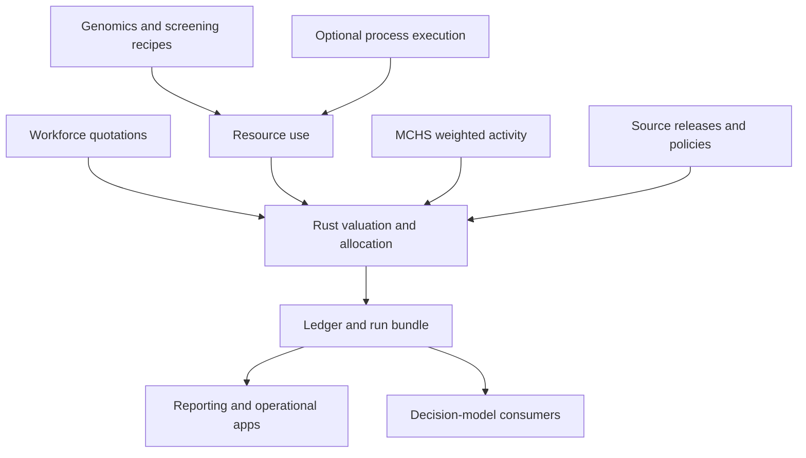

# Framework design

Status: accepted architectural direction for implementation, 8 November 2026.
Dapane currently contains project context and plans; the interfaces below describe
the intended runtime, not an available API. [Requirements](requirements.md) define
acceptance, [decisions](decisions.md) explain choices, and the [roadmap](roadmap.md)
sequences delivery.

## 1. Boundary and dependency direction

Dapane owns quantities, quotation application, valuation policies, allocation,
component ledgers and reproducibility. Domain packages own employment conditions,
laboratory and screening recipes, classifications and programme rules. Keep these
packages optional and preserve their independent APIs during migration.

A minimal static calculation uses the core without a table engine, simulator,
ontology reasoner, game solver or remote service. Typed packages and versioned file
adapters are the first plugin mechanism; a dynamically loaded native Rust ABI and a
general formula language are deferred until real consumers justify them.

Kairos produces neutral usage events when simulation is required; it does not
depend on Dapane. UOGTO supplies optional semantic mappings. A Power App, CareOps
workflow or decision-model application consumes the same calculation boundary.
Ownership and provider dependencies are detailed in [ecosystem](ecosystem.md).

## 2. Contract model

Names below are design vocabulary. Final field names and schema versions are
deliverables of the core-contracts track.

| Record | Minimum meaning to preserve |
| --- | --- |
| ResourceUse | Stable use identity; resource and activity links; cost object; quantity/unit; instant or half-open interval; evidence basis and source/correction identity. |
| ActivityMeasure | Service/activity identity; activity kind; classification system and edition; quantity/unit; measurement provenance. |
| UnitQuote | Resource or activity-kind target; exact amount and denominator; currency and valuation basis; applicability; component coverage; rate-release identity. |
| RateRelease | Immutable source/version; effective and knowledge dates; access/licensing evidence; content digest; correction/supersession relationship. |
| ValuationPolicy | Perspective, valuation basis, horizon, price year, source selection, unit conversion, capital, allocation, inflation/FX, discounting and rounding methods. |
| ValuationLine | Input identity, quotation or explicit recipe, policy, component, result, diagnostics and source lineage. |
| ComponentLedger / CostPool | Source lines and pool membership; allocation method/driver; recipient values and residual; non-duplicating aggregation views. |
| RunBundle | Contract, engine, plugin, method and data versions; input/output digests; completeness; strategy/scenario/draw/replication/perspective/subgroup keys. |

A quotation targets a resource or an activity kind. Applying it requires compatible
units and applicability. MCHS activity funding can therefore be calculated without
manufacturing resource-use records. Activity-to-resource conversion is a separately
declared recipe, not an inference from the presence of a dollar amount.

Keep metadata axes independent: an accessible source is not necessarily official;
an official source does not validate a model; a synthetic source cannot be promoted
through a licence label; a structurally conforming result need not be scientifically
valid. Preserve unknown status where evidence is absent.

## 3. Numerical and economic model

Represent exact values with decimal coefficient/scale or a normalised rational
numerator/positive denominator. Define supported bounds and canonical encoding in
the contract track. Decimal strings and rational pairs cross JSON and language
boundaries without silent float conversion. Arrow/Parquet adapters must preserve
the same semantics, including unsupported precision failures.

Each method declares conversion and rounding points. Retain enough unrounded
information to explain results and reconcile pool residuals. Exact arithmetic
fixtures include fractional working hours, sub-cent quotations and allocations
that cannot be divided evenly at the chosen currency scale.

Within each valuation view:

- Count each resource-use identity once, while allowing separately identified
  perspectives and valuation policies over the same underlying usage.
- Reconcile allocations plus residuals to each source pool. Allocation views do
  not become new programme expenditure.
- Record included components of loaded rates, so salary, on-costs and overhead
  are not accidentally counted twice.
- Keep acquisition expenditure, depreciation and economic annualisation as
  alternative treatments unless a model explicitly justifies their relationship.
- Preserve fixed/variable and average/marginal classifications relative to a
  scenario and horizon. Released capacity is not automatically a cash saving.

Rate selection is deterministic for a pinned release and knowledge cutoff. Split
usage at relevant effective-rate boundaries under a declared exposure rule; do
not assume uniform usage where the evidence does not establish it. Historical
replay and retrospective corrections are separate runs.

The first kernel covers bounded, independently verified valuation/allocation
operations. Rich capital, discounting, tax or nonlinear pricing methods become
named capabilities with their own reference cases. A generic policy field does
not imply that every method named by it has been implemented.

## 4. Execution and plugin contract

The planned execution sequence is validation, source selection, valuation,
allocation, aggregation and evidence/report generation. Each stage returns typed
diagnostics. Required missing inputs prevent a complete result; deliberate
exclusions are visible. Empty, zero, incomplete and unsupported results differ.

A plugin manifest identifies the package/version, compatible contract versions,
provided recipes/quotations, capabilities and maturity, data releases, source
rights, reporting profiles and reference fixtures. Registration is explicit.
Data-pack loading does not imply permission to execute arbitrary plugin code.

Source-use records and run bundles are immutable inputs/results. Corrections
create new identities with lineage. A completed bundle includes its input and
output digests; interrupted or partial output cannot acquire complete status.
Atomic file publication and worker job-state handling are separately qualified
delivery details.

Revaluation of unchanged usage should be possible without rerunning a process.
If price affects behaviour or adoption, the application explicitly invokes a new
scenario and records that feedback. Incremental caching is a later optimisation:
its result must first match a full recomputation.

## 5. Workspace and language boundaries

The proposed workspace separates core contracts/arithmetic, optional data IO, CLI,
Python binding, later C ABI/R binding and optional WASM. Exact crate names and
dependency versions are implementation decisions, not established package APIs.
See [technology stack](tech-stack.md) for dependency qualification.

Python uses PyO3/maturin and thin Polars/Arrow conveniences. R may use extendr to
call the same Rust core directly and need not wait for the C ABI. Julia calls the
versioned C ABI and resolves qualified native artifacts. No wrapper requires a
second implementation of the economic rules or another host language at runtime.

At an FFI boundary, specify lengths, ownership, lifetimes, error mapping, version
negotiation and allocator/free symmetry. Contain panics and keep Rust layouts and
unwinding inside Rust. Zero-copy is an optimisation allowed only where layout and
lifetime guarantees are demonstrated. Exact values may need structured host
representations instead of ordinary floating-point vectors.

## 6. Newborn screening as composition

Compose a programme recipe from workforce quotations and laboratory activities.
Keep infant, screening episode, specimen/card, collection attempt, assay, batch,
result, recall, confirmation and follow-up identities separate. A specimen can
serve several assays and a batch several infants; neither relationship justifies
copying the shared resource cost into every member.

Programme inputs select information/consent, collection, transport/accession,
quality checks, initial and repeat/reflex tests, result handling, confirmation,
referral and programme overhead. Branch probabilities and timing have sources;
there are no universal clinical defaults in the core or ontology.

Start with the synthetic shared-batch example already proposed in UOGTO, then add
repeated collections, failed assays, spare capacity and capacity steps. Preserve
separate eligible-birth, participating-infant, valid-screen, completed-pathway and
diagnosis denominators. Model additional conditions using explicit incremental
comparators. Lifetime outcomes come from the linked health-economic model.

## 7. Operational surfaces

The baseline Power Platform route uses a Canvas app and standard SharePoint
connector for inputs, run status and summaries. Immutable request/result bundles
live in files; manual CLI execution establishes the exchange contract first.
CareOps remains the operational application owner.

An independently operated authorised worker may later claim jobs and invoke the
same engine. Its contract includes scoped identity, idempotency, retries,
cancellation, incomplete-output handling and audit. An authenticated API/custom
connector is a separate optional premium route. Actual app/flow/environment
entitlements must be checked; a queue does not remove obligations behind it.

A PCF component carrying the same Rust/WASM core is an experiment until target
hosts, CSP, assets, memory and lifecycle behaviour pass parity and usability
checks. Neither the standard-connector classification nor a browser prototype
establishes tenant approval or deployment. Power Fx never owns separate pricing
or allocation equations.

## 8. Reporting, processes and decision models

Use pinned UOGTO mappings and standards_check sources to produce conditional
reporting profiles. Keep original identifiers and extraction scope. Reporting
assertions point to evidence; appraisal, verification and empirical validation
remain separate. Semantic validation is optional at runtime and is not a
scientific-validity certificate.

Process adapters progress from observed events to XES/OCEL, bounded Petri-net/PNML
models and a named BPMN subset. Timing, resource occupation, rework and routing
assumptions are explicit. Preserve object relationships and reject unsupported
semantics rather than flattening them. Reuse rust4pm and Kairos capabilities at
qualified versions; do not create a second general simulator in Dapane.

Decision consumers receive aligned strategy, draw, replication, perspective and
subgroup outputs. Voiage owns qualified information/perspective/heterogeneity
methods; Innovate supplies adoption and utilisation trajectories; Paignia consumes
explicitly transformed payoffs for supported games. Clinical outcomes and
strategic price setting are outside the valuation kernel.

## 9. Qualification and migration

Use independently calculated examples alongside historical regression comparators.
Qualify workforce and genomics against one Rust implementation before widening
the core. Installed artifacts are required evidence for each language/platform
claim. Preserve existing domain APIs through adapters and document rollback to
the preceding qualified version.

Begin with deterministic CPU execution. Parallelism, GPU, distributed execution,
differentiable methods and federated calibration each need a justified workload
and specific correctness/performance evidence. [Research and validation](research-validation.md)
defines the benchmark programme; a plan or synthetic case is not a frontier claim.

Consolidation follows functioning consumers and review of unique assets, source
rights, scholarly history and recovery. This design archives no repository and
selects no project licence or registry release.

## Reference interfaces

The binding directions follow the primary documentation for
[PyO3](https://pyo3.rs/main/), [maturin](https://www.maturin.rs/),
[extendr](https://extendr.rs/) and
[Julia C calls](https://docs.julialang.org/en/v1/manual/calling-c-and-fortran-code/).
Optional bulk interchange should be assessed against the
[Arrow C data interface](https://arrow.apache.org/docs/format/CDataInterface.html).
The [ecosystem record](ecosystem.md) contains the originating repository revisions
and source/deployment references. Recheck capabilities and exact versions during
implementation; these links are design references, not installed-artifact evidence.
