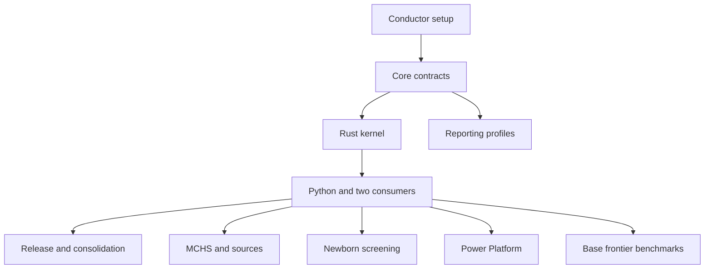

# Dapane roadmap

This is the coordinating roadmap for Dapane. The repository now has a bounded
Rust/CLI/Python candidate, exact schemas and synthetic reference consumers. Its
[implemented contract](../docs/contract-v0.1.md) and
[runtime evidence](../docs/runtime-verification.md) define what works. Existing
provider migration, richer methods, deployed apps and comparative research remain
open. [Track metadata](tracks.md) records current status.

The [earlier MCHS design](https://github.com/edithatogo/mchs/blob/d7935044821d072a194d80e9cd4f5b9174fa9652/docs/roadmaps/dapane-framework.md)
is the source proposal. Dapane now owns delivery of the shared framework. MCHS,
workforce, genomics and the other providers retain their specialist responsibilities;
their implementation tasks and releases are not marked complete by this roadmap.

## Delivery principles

- Deliver a small independent numerical boundary before broadening domain coverage.
- Establish independent arithmetic and economic reference cases before migrating code.
- Use Python and two independent domain consumers to prove that the abstraction works.
- Keep optional integrations independently installable and independently qualified.
- Advance by observed acceptance evidence rather than fixed calendar estimates.
- Reuse provider contracts and maintained dependencies, with exact version/source
  qualification at implementation. A roadmap is not evidence that a provider is ready.

## Delivery gates

| Gate | Owning tracks | Observable outcome |
| --- | --- | --- |
| G0 — project context | `conductor_setup_20261108` | Navigable requirements/design, acyclic tracks, validated links/status and recorded publication. |
| G1 — common contract | `core_contracts_20261108` | Machine-readable schemas and independent exact reference cases for resources, weighted activity, dates, valuation and allocation. |
| G2 — native kernel | `rust_kernel_20261108` | Standalone Rust/CLI passes the supported fixtures and conservation/error checks without optional runtime dependencies. |
| G3 — two consumers | `python_two_consumers_20261108` | Installed Python wheels run a workforce calculation and a genomic workflow through one numerical implementation. |
| G4 — first release | `release_consolidation_20261108` | Only qualified core/CLI/Python capabilities are packaged with exact compatibility, source and migration evidence. |
| G5 — composed domains | `mchs_source_adapters_20261108`, `newborn_screening_20261108`, `reporting_profiles_20261108` | Separately qualified activity/source and newborn/reporting capabilities, preserving economic meaning and provenance. |
| G6 — optional surfaces | `power_platform_20261108`, `polyglot_bindings_20261108` | Each selected app, R, C ABI or Julia surface has its own installed/host evidence. |
| G7 — process and decisions | `process_models_20261108`, `decision_integrations_20261108` | Bounded process/event semantics and correctly paired decision outputs through qualified provider contracts. |
| G8 — comparative research | `frontier_benchmarks_20261108` | Reproducible comparisons supporting the actual claims made; advanced experiments retain their own prerequisites. |

These gates describe outcomes, not a requirement to finish every row before release.
G4 can qualify core/CLI/Python after G3; it does not wait for G5–G8. Reporting-profile
work can begin after contracts, and R/Julia, process and decision branches can begin
after the native kernel. Newborn recipe and synthetic-case work does not wait for the
optional reporting adapter; selecting reporting/profile support adds its own acceptance
prerequisite. Optional Arrow/Parquet IO is qualified only if needed by the selected
first consumers, or explicitly deferred without blocking scalar core/CLI/Python.
Source acquisition and bounded protocol design can proceed
earlier where they do not assume an unimplemented interface.

## Local prerequisite graph

The graph shows track-level prerequisites. Experiment-specific and provider readiness
conditions remain in the relevant specification and plan. Only local track IDs belong
in metadata `dependencies`; `external_dependencies` records provider obligations.

Independent native integration branches:

| Track | Local prerequisite | Additional branch conditions |
| --- | --- | --- |
| `polyglot_bindings_20261108` | Rust kernel | R calls Rust directly; Julia waits for that track's C ABI, not for R or Python. |
| `process_models_20261108` | Rust kernel | Pin and qualify each format/provider; simulated Kairos use waits for its neutral usage contract. |
| `decision_integrations_20261108` | Rust kernel | Each Voiage, Innovate or Paignia example requires the exact supported provider method and input contract. |

## Implemented numerical slice and next migration

The first contract, exact kernel, CLI and thin Python binding are implemented for
bounded synthetic workforce, genomics, funding, newborn and sub-cent allocation
cases. These establish the numerical boundary and installed-package behaviour;
they do not complete migration of the existing provider libraries. G1/G2 have
evidence for profile 0.1; full track acceptance, provider-based G3 and release G4
remain open.

Next, qualify the real workforce release adapter and genomics recipe extraction,
preserving jurisdiction/employer/source scope and loaded components. Resolve the
workforce import namespace and incompatible provider interpreter pins in their
own repositories. The [provider review](../docs/provider-boundaries.md) pins the
actual inspected contracts and documents fields that must not be silently lost.

Contract 0.1 already verifies fractional exposure, effective/knowledge dates,
half-even rounding, largest-remainder allocation, duplicate/component rejection,
incompatible quotation targets and missing versus zero. Usage must be explicitly
segmented into dated quantities; automatic interval splitting, retractions and
capital/economic extensions need new supported methods and fixtures.

## Newborn screening as the next new domain

[Newborn screening](tracks/newborn_screening_20261108/index.md) composes qualified
workforce and laboratory recipes. It preserves infant, specimen, assay, batch and
confirmation identities and declares output denominators explicitly.

The implemented synthetic example totals 150 invented currency units: two collections
at 10 each, one batch at 100 and one confirmation at 30. A 50/50 batch allocation
gives infant views of 60 and 90 without adding another batch expense. Repeat,
failed-assay, partial-batch and capacity-step cases follow. Real programme support
requires a scoped source-qualified programme pack and independent calculations. These
source requirements do not block earlier synthetic recipe and costing qualification.

Reporting uses the optional [profile adapter](tracks/reporting_profiles_20261108/index.md)
with UOGTO semantics and standards_check sources. Their upstream schemas/mappings do
not establish a validated newborn runtime. Power Platform is not a prerequisite for
this domain or its reporting. The reporting adapter is a task-specific prerequisite
for advertised profile support, not a prerequisite for newborn Phases 1–2.

## Optional delivery and process branches

The [Power Platform track](tracks/power_platform_20261108/index.md) starts with
standard SharePoint connectors and manual versioned-file/CLI exchange. An authorised
worker, premium API and browser-local WASM/PCF candidate retain separate capability
states and actual host/entitlement checks. No Power Fx implementation duplicates the
numerical core.

The [polyglot track](tracks/polyglot_bindings_20261108/index.md) has independent R
and Julia branches. R's extendr route calls Rust directly; Julia uses a separately
qualified C ABI and native artifacts. A qualified R release need not wait for Julia.

The [process track](tracks/process_models_20261108/index.md) progresses from observed
events/XES/OCEL to bounded Petri-net/PNML and named BPMN subsets. Each addition needs
branching, concurrency, rework, cancellation and shared-resource evidence before it
is advertised. Kairos owns neutral execution; valuation follows the resulting usage.

## Research without a global optional-feature blocker

The [frontier benchmark track](tracks/frontier_benchmarks_20261108/index.md) has the
two installed consumers as its base prerequisite. Static missing-cost/double-count
experiments and incremental-revaluation comparisons do not wait for process simulation,
Power Platform or decision-library integrations.

Its advanced experiments have narrower dependencies:

| Experiment | Additional readiness required |
| --- | --- |
| Object-centric newborn pathways versus flattened traces | The relevant newborn and process-model capabilities and independent expected allocations. |
| Measurement priorities and value of further costing evidence | A qualified decision adapter and Voiage method with paired draws. |
| Adoption, capacity and strategic-pricing feedback | The selected Innovate/Paignia capabilities and explicit application-level feedback/payoff contracts. |
| External or multi-site transportability | Authorised scoped data, independently checked calculations and suitable comparison populations. |
| Aggregate/federated calibration | Explicit privacy/utility methodology and evidence; no compulsory central patient-record store. |

Retain unfinished experiments as pending. A result is qualified per experiment,
source and capability; completing the benchmark infrastructure does not establish
all research hypotheses or justify a broad frontier claim.

## Release and consolidation boundaries

[Release assurance](tracks/release_consolidation_20261108/index.md) follows the first
two consumers and applies again to each later capability. It includes licensing and
registry identity decisions, reproducible installed artifacts, dependency/source
checks, compatibility and bounded performance evidence. It does not require another
approval board or a second evidence repository.

Keep mchs, microcosting_healthworkforce and microcosting_genomics as domain packages.
Review hwcc and cobra-costing as conditional archive candidates; preserve unique rules,
workbooks, history and research. Retain scholarly identities for tutorials and research
consumers. A recommendation is not an archive action. Re-check current repository state,
establish a working successor and recovery path, and record the authorised scope before
any later archive or removal of duplicated machinery.

## Current status and next action

The numerical candidate and synthetic consumers now have scoped runtime evidence.
Full provider, programme, deployment and research capabilities retain their own
unfinished acceptance criteria; no runtime track is closed merely because a
bounded first profile works.
Use the [registry](tracks.md) for current machine-aligned status and the
[workflow](workflow.md) for the next bounded task.
