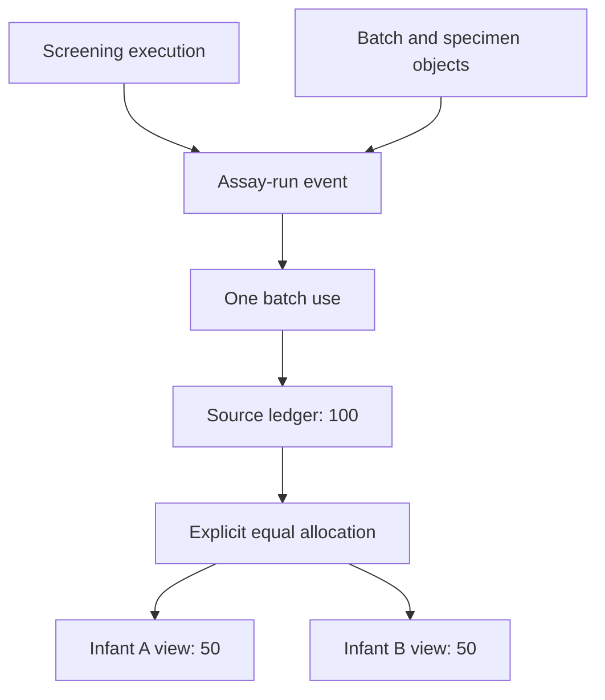

# Event, process and object views

Dapane is an independent valuation engine. Kairos is one optional producer of
simulated quantities; it is not Dapane's scheduler, data model or mandatory
foundation. An observed dataset or static recipe can use the same contract
without constructing a simulation. See the [inspected provider boundaries](provider-boundaries.md)
and the [implemented JSON contract](contract-v0.1.md).

## Three contexts, one source ledger

| View | Question | Contract representation |
| --- | --- | --- |
| Event | Which occurrence generated this use? | `Event.id`, `occurred_on`, and `Usage.event_id` |
| Process | Which execution and activity does it belong to? | `ProcessInstance.id`, model/version, process/activity references |
| Object | Which infant, specimen, assay, batch or other object is involved? | Typed `CostObject`, object associations and qualified relations |

These contexts can coexist. They are not three alternative storage backends or
three charges. A source line is valued once. Context identifies what it relates
to; direct attribution or an explicit pool determines where its monetary value
is assigned. Object associations alone never allocate money.

The two infant views sum to the batch's 100. They are not added back to that 100.
Collections of 10 each plus a confirmation of 30 for infant B produce source
expenditure of 150 and infant views of 60 and 90. All values in the
[newborn fixture](../fixtures/newborn-screening.json) are invented.

## What contract 0.1 does

The kernel validates that referenced events, processes and objects exist, checks
explicit process/activity references for consistency, rejects repeated economic
components of the same use and preserves lineage in its report. It supports
direct object attribution and conserving weighted allocation of shared source
lines. One specimen may relate to multiple assays and a batch to several infants
without copying the batch use. The fixture exercises this relationship structure.

Date-level event occurrence is preserved independently of the service date used
to select an explicit quote. The kernel accepts quantities already supplied by
the caller; it does not infer duration, consumption or causal direction from an
event name, object relation, activity name or process diagram. Records from
multiple process instances can be represented in a request, but a usage line has
at most one explicit process and event context in this first contract.

Event/process totals can be derived as views of source lines using their retained
identifiers. Object views use the report's direct and allocated totals. Do not
flatten the object graph into one trace per infant and then sum duplicated traces.

## Provider responsibilities

An observed-data adapter must define observation completeness, source identities,
corrections and missing events. A static recipe must state its output denominator,
quantity assumptions and batch/capacity rules. A simulator must state event time,
tick scale, committed execution, occupied capacity, consumption and censoring.

For occupancy, charging from queue arrival would conflate waiting with resource
occupation. The future simulation adapter must derive admitted half-open usage
intervals, split preemption or quantity changes and handle open leases at a
declared observation boundary. Transfers must not become consumption. Contract
0.1 requires the caller to supply explicitly segmented point-date quantities;
negative retractions and automatic interval segmentation are unsupported.

Kairos's inspected movement/resource-usage export is still pending. Its existing
lease snapshots are insufficient to reconstruct a full quantitative event ledger.
An actual integration needs a public versioned export and independent trajectory
tests. A synthetic Dapane fixture is not evidence that Kairos integration works.

## Roadmap

The [process track](../conductor/tracks/process_models_20261108/plan.md) owns
observed XES/OCEL import, qualified Petri-net/PNML and BPMN subsets, and Kairos
integration. The core must remain usable without any of those adapters.

Process execution produces physical use or classified activity. Quotations and
valuation policies are applied afterwards. Repricing that fixed use does not
require execution again. If prices affect routing, uptake, staffing or behaviour,
the application runs a new explicit scenario and records the feedback; it must
not claim that ordinary revaluation captures that change.

Object-aware allocation, source-linked evidence and reproducible revaluation
are useful foundations for research. Claims about better measurement,
transportability, decision quality or performance need the comparative studies
in the [research plan](../conductor/research-validation.md).
